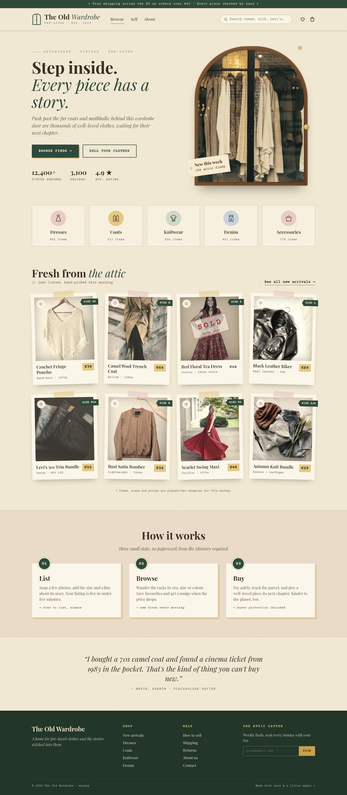

# The Old Wardrobe

A vintage-styled marketplace for secondhand clothes — pre-loved pieces with a story.

This first version is a static homepage mockup.

## Homepage

Desktop:



Mobile:


## View the mockup

Open [`mockup/index.html`](mockup/index.html) in a browser. Styles are inline and the photos are embedded, so it works as a single file (it does load [Playfair Display and Courier Prime](https://fonts.google.com/) from Google Fonts).

## Rebuild

From the repo root, regenerate `mockup/index.html` from the template and the source photos in `mockup/img/`:

```bash
python src/build.py
```

## Re-shoot screenshots

With [Playwright](https://playwright.dev/)’s core package and Chrome installed (`CHROME_PATH` overrides the default `/usr/bin/google-chrome`):

```bash
npm install playwright-core
node src/shot.js
```

That writes `mockup/home-desktop.png` and `mockup/home-mobile.png`.

## Placeholder data

The garments, sizes, prices, and reviews are placeholder examples for this mockup. Photos are from [Unsplash](https://unsplash.com/).
